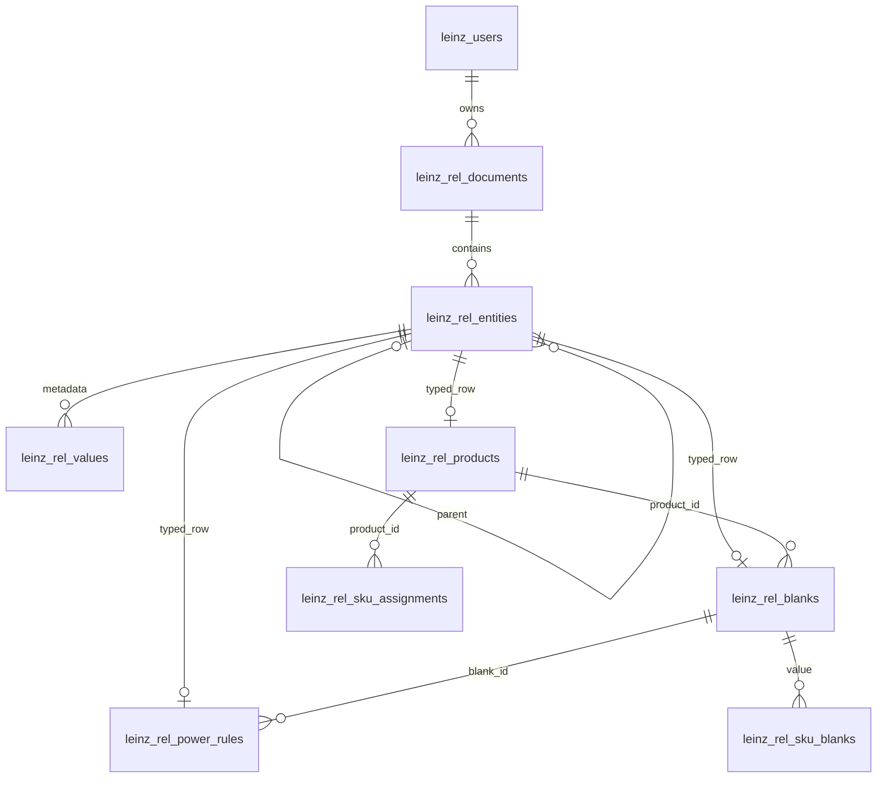

# Normalisasi database Leinz

Pembaruan master Excel: database dan aset paket sudah dibandingkan dengan
`DMO UNI OSA WXG TRN.xlsx` (SHA-256 dan hasilnya di
[`workbook-sync-report.json`](../database/workbook-sync-report.json)). Master
berisi 91 produk, 796 blank dan 6.829 aturan; indeks 1.61 dipertahankan sebagai
katalog saja. Backup sebelum penerapan berada di direktori yang dicatat laporan.
ID produk/blank/rule yang cocok dipertahankan, begitu juga seluruh SKU existing.

Fitur hapus: gunakan tombol **Hapus** per item atau checkbox dan **Hapus terpilih**
di setiap master. **Pilih semua ditampilkan** hanya memilih item pada tampilan
yang sedang terlihat. Produk bahan ikut menghapus blank dan aturan miliknya;
blank ikut menghapus aturan miliknya. Item yang masih di-assign SKU atau dipakai
dalam draft/riwayat konsultasi ditolak. Lepaskan referensi terlebih dahulu atau
gunakan arsip bila referensi harus dipertahankan. Penghapusan SKU memeriksa
referensi draft/riwayat. Pilihan dipertahankan bila penyimpanan gagal dan baru
dikosongkan setelah konfirmasi server. Operasi memakai revisi dan transaksi
yang sama dengan CRUD lainnya, dan tidak menghapus JSON backup lama.

Sinkronisasi workbook dapat diulang melalui
`npm run db:sync-materials -- --file "file.xlsx" --apply-db --apply-assets`.
Tanpa flag apply, perintah hanya membandingkan aset dan menulis laporan.
Backup dibuat sebelum apply, dan hasil database dibaca kembali untuk verifikasi.
Makro/instruksi dalam workbook tidak dijalankan; sel diproses sebagai data master.

**Pembaruan skema 4 — range SKU per diameter:** jalankan `npm run db:migrate`
sebelum restart backend terbaru. Migrasi
[`004_sku_power_ranges.sql`](../database/004_sku_power_ranges.sql) menambah tabel
`leinz_rel_sku_power_ranges` dengan kolom `diameter`, `sph_min`, `sph_max`,
`cyl_min`, `cyl_max`, `add_min`, dan `add_max` bertipe DOUBLE serta FK entitas.
Setiap varian indeks memiliki banyak baris `powerRanges`; diameter dan semua
batas power dicocokkan pada baris yang sama. Batas antarbaris tidak digabungkan.

Konfigurasi lama `power` tetap dapat dibaca tanpa perubahan data. Saat dibuka di
editor, draft diubah menjadi baris per diameter berdasarkan blank yang telah
di-assign dan batas diameter lama jika ada. Perubahan baru disimpan setelah
menekan **Simpan SKU**. Bila diameter belum tersedia pada konfigurasi lama,
editor meminta pengguna mengisinya; sistem tidak menebak diameter. Tombol
**Tambah range diameter** dan hapus baris mengelola setiap konfigurasi secara
mandiri. Snapshot konsultasi lama tetap dipertahankan.

JSON ekspor SKU mendukung `variants[].powerRanges[]`. Template CSV/Excel tetap
menggunakan kolom diameter yang sudah ada; beberapa baris pada satu indeks kini
boleh memiliki rentang power berbeda. Rentang yang berbeda disimpan sebagai
baris per diameter, sementara baris supplier/BC yang mengacu pada range sama
tidak menggandakan range. Assignment blank dan aturan bahan baku tetap diperiksa.

Contoh konfigurasi SKU TEST (ADD 0–0):

| Diameter | SPH minimum | SPH maksimum | CYL minimum | CYL maksimum |
| --- | ---: | ---: | ---: | ---: |
| 65 mm | -4.00 | +6.00 | -3.00 | 0.00 |
| 70 mm | -8.00 | +2.00 | -3.00 | 0.00 |

Resep SPH -6 hanya boleh memakai baris Ø70, sedangkan SPH +4 hanya boleh memakai
baris Ø65. Diameter lain tidak otomatis diizinkan. Nomor skema akhir kini 4;
bagian berikut menjelaskan normalisasi dasar pada migrasi 003.

Implementasi ini ditujukan untuk **MySQL 5.7.24 atau patch 5.7 berikutnya**, dengan
InnoDB dan utf8mb4. Backend yang memakai tabel `leinz_*` berada di `server/db.mjs`
(Node.js), bukan bootstrap CodeIgniter `index.php` pada folder sementara IDE.
Skema baru bernomor **3**; versi format API dan berkas impor tetap seperti semula.

## Cakupan data yang ditemukan

| Sumber lama | Isi | Penyimpanan baru |
| --- | --- | --- |
| `leinz_catalog_documents`: materials | Produk, blank, aturan SPH/CYL/ADD dan baris sumber | products, blanks, power_rules, source_rows, optical_profiles |
| `leinz_catalog_documents`: shapes | Bentuk frame dan koordinat kontur | frame_shapes, shape_points, shape_aliases |
| `leinz_catalog_documents`: tints | Master tint dan swatch acuan | tint_items, swatches |
| `leinz_workspace_documents`: skus | SKU bersama, varian, rentang power dan assignment blank | sku_items, sku_variants, sku_power, sku_assignments, sku_blanks |
| `leinz_user_documents`: state | Draft simulator per akun | states, choices, cameras, optics, optical_profiles |
| `leinz_user_documents`: saved | Daftar konsultasi dengan state dan snapshot historis | consultations, states, snapshots dan tabel komponen snapshot |

Semua nama tabel baru di atas memiliki awalan `leinz_rel_`. Tabel users, sessions,
catalog_revision, dan schema_migrations sudah relasional dan tetap dipakai.
Tabel dokumen lama mempertahankan JSON asli serta menyediakan revisi dan timestamp
untuk concurrency control. Tidak ada DROP, TRUNCATE, penggantian ID akun, penghapusan
sesi atau reset revisi pada migrasi.

Inventaris paket referensi: 19 produk, 186 blank, 2.026 aturan power,
2.689 nomor baris sumber, 13 bentuk frame dan 66 tint. **Database operasional dapat
berisi data berbeda**; backfill membaca seluruh baris database, bukan menggantinya
dengan aset paket. Tidak diperlukan contoh JSON tambahan untuk format yang sudah
dipakai aplikasi ini.

## Struktur dan tipe kolom

DDL lengkap, termasuk setiap kolom dan FK, tersedia di
[`003_relational_documents.sql`](../database/003_relational_documents.sql).
Definisi pemetaan ada di [`server/relational.mjs`](../server/relational.mjs).

| Kelompok | Kolom utama dan tipe |
| --- | --- |
| products | id ASCII VARCHAR(128) UNIQUE; supplier/code VARCHAR(80); name VARCHAR(200); index VARCHAR(8); activeForSimulator/active TINYINT |
| blanks | id ASCII VARCHAR(128) UNIQUE; product_id FK; base_curve, diameter, ct, et DOUBLE |
| power_rules | id ASCII VARCHAR(128) UNIQUE; blank_id FK; sph_from/to, cyl_from/to, add_from/to DOUBLE; jumlah duplikat dan flag |
| source_rows | value DOUBLE untuk nomor baris sumber; satu baris per nomor, urutan asli dipertahankan |
| frame_shapes | code ASCII VARCHAR(128) UNIQUE; name VARCHAR(140); dimensi/rasio DOUBLE; geometri dan provenance pada kolom terpisah |
| shape_points | x/y DOUBLE; satu baris per titik dengan ordinal pada entitas induknya |
| tint_items | code ASCII VARCHAR(128) UNIQUE; name VARCHAR(160); kind VARCHAR(16); group VARCHAR(32); nominal_percent DOUBLE; warna VARCHAR(7); catatan VARCHAR(2000) |
| sku_items | id ASCII VARCHAR(128) UNIQUE; code VARCHAR(64); name VARCHAR(140); active TINYINT; created_at/updated_at berupa teks sumber |
| sku_variants / sku_power | index VARCHAR(8), enabled TINYINT; enam batas power DOUBLE pada satu baris power per varian |
| sku_assignments / sku_blanks | id, product_id FK; supplier VARCHAR(80); satu blank per baris dengan value FK ke blanks.id |
| consultations | id ASCII VARCHAR(128), title VARCHAR(100), created_at VARCHAR(40); identitas konsultasi terikat dokumen akun |
| states / choices | frame, resep, sentrasi, UV dan boolean pada kolom; dua baris pilihan A/B; indeks dan referensi master berupa string |
| cameras / optical_profiles | yaw/pitch/zoom dan parameter optik DOUBLE; sumber serta referensi pada kolom teks |
| snapshots dan komponen | schema, judul, status, frame, resep, preview, pilihan serta frame display pada tabel terpisah |

Pilihan tipe mempertahankan kontrak data yang ada:

- `DOUBLE` mengikuti representasi angka JSON/JavaScript, termasuk koordinat dan
  presisi ketebalan; migrasi tidak membulatkan ke skala DECIMAL tertentu. Nilai
  tersebut tetap divalidasi menggunakan batas aplikasi sebelum CRUD baru.
- Indeks disimpan sebagai string agar `1.50` tidak berubah menjadi `1.5`. ID dan
  FK memakai ASCII binary collation sesuai identitas yang peka huruf besar/kecil.
  Nama/kode produk yang ditampilkan memakai utf8mb4, termasuk aksen dan emoji.
- Timestamp JSON historis dipertahankan sebagai string agar offset zona waktu,
  milidetik dan format ekspor asli tidak berubah. Timestamp operasional SQL yang
  sudah ada tetap `DATETIME` UTC.
- Kolom domain nullable untuk kompatibilitas data lama. `field_mask` dan
  `child_mask` merekam atribut tidak ada, null, nilai bertipe, atau ekstensi.
  Dengan demikian membaca data tidak menambahkan default baru ke respons.

Tabel pendukung:

- `leinz_rel_documents`: PK document_id, scope, document_key, user_id FK ke users,
  root_type, is_null, migrated_sha256 dan migrated_at. Contoh ID: `catalog:materials`,
  `workspace:skus`, `user:42:saved`. Akun lain memiliki namespace terpisah.
- `leinz_rel_entities`: PK (document_id,node_id), FK ke documents dan FK induk
  ke entities; relation_name, ordinal, entity_type dan mask. Node ID adalah hash
  identitas dan relasi induk, sehingga pengurutan ulang tidak mengganti identitas
  produk/SKU. Setiap tabel domain mempunyai PK/FK ke entitas ini.
- `leinz_rel_values`: atom metadata tambahan per entitas. Kolom value_kind,
  string_value, number_value, boolean_value, parent_value_id, member_name dan
  ordinal mempertahankan struktur metadata, array kosong, objek kosong, dan null.
  **Tidak menyimpan teks JSON atau kolom JSON baru.**

Metadata seperti ringkasan/provenance sumber, hasil kalkulasi historis yang
bervariasi, salinan referensi tint/blank pada snapshot, dan atribut tambahan yang
belum dikenal menggunakan tabel atom ekstensi. Jadi bagian fleksibel itu memakai
model atribut/nilai bertipe; bukan semua metadata memiliki tabel domain tersendiri.
Data operasional utama tetap mempunyai tabel dan kolom bertipe yang bisa di-JOIN.
Snapshot tidak diberi FK ke master aktif agar riwayat dengan master lama atau
referensi yang telah diarsipkan tetap dapat dibaca. Validasi referensi SKU pada
backend tetap berlaku, ditambah FK produk/blank pada penyimpanan baru.

## ERD ringkas



Relasi induk entitas juga membentuk hierarki domain:

```text
materials -> products; blanks; power_rules -> source_rows
shapes -> frame_shapes -> shape_points; shape_aliases
tints -> tint_items; swatches
skus -> sku_items -> sku_variants -> sku_power; sku_assignments -> sku_blanks
state -> choices (a/b), cameras, optics -> optical_profiles
saved -> consultations -> state; snapshots -> snapshot_choices, snapshot_frames,
                                         prescriptions, previews -> frame_displays
```

## Menjalankan migrasi existing

1. Hentikan seluruh instance aplikasi dan penulis database lain, termasuk backend
   versi lama. Siapkan backup database lengkap dan pastikan backup dapat dipulihkan.
   Contoh: `mysqldump -u USER -p --single-transaction --routines --triggers --hex-blob --result-file=backup-sebelum-normalisasi.sql DATABASE`.
   Simpan backup di lokasi yang sesuai untuk data akun/konsultasi Anda.
2. Pasang kode ini dan arahkan `.env` ke database yang akan dimigrasikan.
3. Jalankan `npm run db:migrate`. Perintah ini membuat tabel tambahan, mengunci
   dokumen asal dan revisi katalog, mengekstrak seluruh katalog/SKU/dokumen semua
   akun, lalu membaca kembali dari tabel baru dan membandingkannya dengan sumber.
   Dokumen akun dibaca satu per satu setelah penguncian agar JSON semua akun tidak
   perlu ditahan sekaligus di memori.
4. Jika semua dokumen sama, migrasi mencatat versi 3 dan commit satu transaksi
   backfill. JSON asal, revisi, timestamp lama, akun dan sesi tidak berubah.
5. Jalankan `npm run doctor`, lalu `npm start`. Periksa login, master, draft,
   riwayat, simpan/edit/hapus, impor dan dua sesi bersamaan.

`npm run db:seed` hanya diperlukan bila katalog memang belum tersedia. Katalog
existing tidak diganti oleh paket referensi. Instalasi baru tetap memakai urutan
`db:migrate`, `db:seed`, `admin:create`, `doctor`.

DDL dipisahkan dari transaksi data karena CREATE TABLE dapat melakukan implicit
commit di MySQL. Jika backfill gagal, semua hasil ekstraksi dan marker versi 3
di-rollback; tabel kosong hasil DDL dapat tetap ada dan aman untuk percobaan ulang.
Lihat [dokumentasi MySQL tentang implicit commit](https://dev.mysql.com/doc/refman/5.7/en/implicit-commit.html).
Dokumen/key atau struktur yang belum didukung menghentikan migrasi, sehingga tidak
ada data asing yang diam-diam dilewati. FK yang tidak cocok juga menghentikan
migrasi; perbaiki sumber/mapper berdasarkan datanya sebelum mencoba kembali.

Migrasi bisa dijalankan ulang. Setelah versi 3 tercatat, JSON lama **tidak diimpor
kembali** karena JSON itu merupakan cadangan saat cutover, bukan data terbaru.
Sesudah sistem digunakan, backup rutin harus meliputi tabel relasional baru juga.
Jangan menjalankan backend lama bersamaan dengan backend baru. Jangan rollback
kode ke backend JSON setelah ada perubahan baru tanpa memindahkan perubahan
tersebut atau memulihkan backup lengkap yang sesuai; JSON lama sudah tertinggal.
Tidak ada perintah penghapusan kolom backup di paket ini.

## CRUD dan kontrak API

`MysqlStore` merekonstruksi objek dari kolom dan JOIN tabel baru. Endpoint dan
respons `{value, revision}`, bootstrap, unduhan katalog, format impor/ekspor serta
isolasi per akun tetap sama. **Frontend tidak memerlukan perubahan.**

- SELECT: tabel relasional dalam satu transaksi REPEATABLE READ, agar revisi dan
  seluruh komponen dokumen berasal dari snapshot yang sama.
- INSERT/UPDATE: validasi lama tetap berjalan; upsert baris domain dan atom
  metadata serta pembaruan revisi berada dalam transaksi yang sama.
- DELETE: aplikasi existing mengirim daftar baru melalui PUT ketika menghapus
  riwayat/SKU atau mengganti cakupan aturan. Entitas yang hilang dibuang beserta
  turunannya di tabel baru; JSON backup tetap ada. Penghapusan produk/blank/shape/
  tint harus menyertakan intent `deletion` (kind dan ids); backend membangun ulang
  hasil penghapusan dan memeriksa semua referensi. PUT/impor biasa tetap menolak
  penghilangan identitas existing. Arsip tetap tersedia bila item masih digunakan.
- Konflik revisi tetap HTTP 409. Konflik membaca ulang data yang sudah commit dari
  transaksi baru, sehingga tidak menggabungkan revisi baru dengan isi lama.
- Gagal di tengah penyimpanan membuat seluruh perubahan dan revisi rollback.

Contoh query relasional biasa:

```sql
SELECT p.id, p.name, p.`index`, b.id AS blank_id, b.diameter,
       r.sph_from, r.sph_to, r.cyl_from, r.cyl_to, r.add_from, r.add_to
FROM leinz_rel_products p
JOIN leinz_rel_blanks b ON b.product_id = p.id
JOIN leinz_rel_power_rules r ON r.blank_id = b.id
WHERE p.id = 'DMO:SPHG60'
ORDER BY b.base_curve, r.sph_from;

SELECT c.id, c.title, c.created_at, e.ordinal
FROM leinz_rel_consultations c
JOIN leinz_rel_entities e
  ON e.document_id = c.document_id AND e.node_id = c.node_id
WHERE c.document_id = 'user:42:saved'
ORDER BY e.ordinal;

SELECT document_id, migrated_sha256, migrated_at
FROM leinz_rel_documents ORDER BY document_id;
```

Perubahan langsung lewat SQL pada tabel domain dapat melewati revisi, mask dan
validasi aplikasi. Gunakan CRUD backend untuk pembaruan aplikasi.

## Paket SQL instalasi dan pengujian

`npm run db:export-install` menghasilkan ulang DDL dan paket master. Setelah impor
SQL, **tetap jalankan `npm run db:migrate`** untuk backfill terverifikasi. SQL DDL
saja tidak mencatat versi 3; server menolak mulai bila migrasi belum selesai.
Paket SQL master merupakan referensi instalasi, bukan backup database operasional.

```sh
npm test
npm run test:relational
# Hanya database uji terpisah dengan nama leinz_test_*:
# LEINZ_ALLOW_TEST_DB=1, MYSQL_DATABASE=leinz_test_normalization,
# dan MYSQL_HOST/PORT/USER/PASSWORD menuju instance pengujian.
npm run test:relational:mysql
npm run test:mysql
```

Kedua pengujian MySQL menghapus/membuat ulang tabel dalam database uji dan menolak
berjalan tanpa opt-in serta nama database yang sesuai. Suite migrasi mencakup
rollback setelah kegagalan SQL di tengah backfill, key asing, pemeliharaan seluruh
data akun dan dokumen, Unicode, JSON backup, revisi, delete dan rerun. Suite API
mencakup CRUD, autentikasi, isolasi akun, concurrency dan rollback penulisan master.

Verifikasi terbaru: suite aplikasi dan pencocokan seluruh 6.829 baris Excel lulus.
Database MySQL 5.7.24 yang dikonfigurasi sudah diperbarui ke skema 4 dan data
workbook, lalu dibaca kembali untuk verifikasi. SQL hapus FK diuji memakai record
sementara dalam transaksi yang selalu di-rollback; checksum master dan revisi
operasional tetap sama setelah pengujian. Penolakan blank yang masih di-assign
SKU juga diverifikasi langsung. Suite penuh pada database uji terpisah belum
dijalankan karena akun database tidak memiliki izin CREATE DATABASE; database
operasional tidak dijadikan target suite yang menghapus/membuat ulang tabel.
